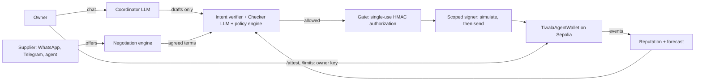

<h1 align="center"><b>TR8DE</b></h1>

<p align="center">
  An AI escrow wallet agent that negotiates with suppliers and pays them on-chain, within limits the contract enforces.<br>
  WeBank FinTechathon 2026 · International Track · Topic F
</p>

<p align="center">
  <a href="https://github.com/shaan8/TR8DE/actions/workflows/ci.yml"></a>
  <a href="https://sepolia.etherscan.io/address/0x2Fc37E4e02F4d10745875710cd54B52429A28C1a"></a>
</p>

<p align="center">
  
</p>

**Watch the console overview (36 seconds, local demo).** Payments, negotiations and the supplier directory;
this clip tours the interface and does not show a completed payment.

https://github.com/user-attachments/assets/8bb2690a-1246-4278-b3dd-da9550c89834

Submission documents: [technical documentation](docs/submission/1-technical-documentation.md),
[security self-assessment](docs/submission/5-security-self-assessment.md),
[execution evidence](docs/submission/6-execution-evidence.md), [5-minute demo plan](docs/submission/demo-plan.md).
The [judging evidence map](docs/submission/1-technical-documentation.md#17-judging-criteria-and-evidence-map)
connects each criterion to tests, hashes and remaining recording work.

## What you can do

Type in the Payments chat. Plain words go to the agent. Commands starting with `/` are yours alone: they are
signed with the owner key, and no model can reach them.

**Wallet and planning**

- "What's my balance and what deals are open?"
- "What is Lumen Textiles' delivery record?" (network reputation and the deposit cap it allows you)
- "Can I afford a PHP 80,000 PO on 2026-10-30?" (cash forecast, with delay, split or top-up options if you can't)

**Watch a wallet status request (35 seconds, local demo).** Shows the request, processing trace and wallet
response. It does not demonstrate every planning example above or broadcast a payment.

https://github.com/user-attachments/assets/0fae76d0-de02-4513-a9f7-ed1f34ba7a6d

**Paying suppliers**

- "Create escrow for Lumen PO-106, PHP 100,000, 20% down, delivery by 2026-10-30". The full PO is locked, then the
  deposit is paid. The agent does this alone when you named the supplier, total, down payment % and PO yourself,
  and the deal is inside your `/limits`. Otherwise it shows a card and waits.
- "Release the down payment for deal 6"
- "Release the balance for deal 6" (only after you `/attest 6`)
- "Cancel deal 5" (only once overdue; the unpaid escrow returns to the wallet)
- On a card: reply `yes`, or say what to change ("make it 15% down") and everything is re-checked. Any other
  message drops the card. A Confirm button approves only the card it is on.

**Negotiating with a supplier**

- "Negotiate 400 m of cotton with Lumen Textiles at PHP 110 a metre, at most PHP 50,000 in total, delivery by
  2026-11-15, keep PHP 20,000 free". Required: supplier, product, quantity, opening unit price, most you will
  commit, latest delivery. Optional: minimum quantity, preferred delivery, opening deposit % (default 10), cash to
  keep free. You confirm the opening with `yes`, and private constraint fields stay buyer-side. Visible offers
  can still reveal your willingness to pay.
- Or use the **Negotiations** tab: the same fields in a form. Pick the supplier's person (WhatsApp, Telegram or the
  simulator) or the supplier's own agent ([supplier API](docs/supplier-api.md)).
- What the supplier can reply:
  - `ACCEPT 359FB6`: accepts that exact offer. Each offer carries its own 6-character code.
  - `REJECT` or "no deal": ends the negotiation.
  - Any other text is read as a counteroffer, never as acceptance.
  - "talk to a person": hands the chat to you.
  - `STOP` / `START`: opt out of messages, or back in.
- Once both sides accept the same offer, a deal inside your authority goes into escrow by itself. Otherwise press
  "Recheck and prepare escrow" and confirm. Each offer is valid for 24 hours, and each negotiation runs at most
  8 rounds before it comes back to you.

**Saving suppliers and their contacts**

- "Save a new supplier, Kalinaw Crafts, payout 0x…". Rules, all checked in code:
  - You must type the address yourself in that message. An address from a PO note, a supplier message or the
    model is refused.
  - It must be `0x` plus 40 hex characters, with a valid checksum if it uses mixed case.
  - It cannot be the wallet, owner or agent address, or an address on the blocklist.
  - A lookalike is refused: an address with the same first and last 4 characters as a saved one, or a name that
    reads like a saved one (`0`/`o`, `1`/`l`, Cyrillic letters).
  - Changing a saved supplier's payout address is flagged.
  - You confirm with `yes` plus the address's last 4 characters, for example `yes 8c1a`. The owner key then signs
    `addSupplier`.
  - The supplier can be paid only after the waiting period: 24 h on our deployment, 10 min with the scripts.
- `/whatsapp Lumen Textiles +63 917 123 4567` links a saved supplier to a WhatsApp number (country code first).
  `/invite Lumen Textiles` makes a one-time Telegram link, valid 7 days. Only saved suppliers can be linked, and
  only linked, opted-in contacts are heard. If `WHATSAPP_ALLOWED_RECIPIENTS` is set, only those numbers can be messaged.

**Your commands**

- `/attest N`: confirm delivery of deal N, so its balance can be released
- `/approve N`: approve a deal above your approval threshold
- `/limits`: show the agent's envelope. `/limits 200000 150000 150000` sets it, in pesos: per deal, per day, and
  how much it may commit on its own
- `/dispute N`, then `/resolve N release` or `/resolve N refund`: freeze a deal, then settle it
- `/freeze`, `/unfreeze`: stop the agent and pause the wallet on-chain, then resume
- `/anchor`: write the audit log's head hash to Sepolia, so later edits are detectable
- `/tick`: run the monitor now (deadlines, attestations, balances). `/verify`: check the audit chain
- `/guide`: show all of this in the app

**Watch command help (32 seconds, local demo).** Shows `/guide`, `/limits` and owner-command usage help.
It does not show delivery attestation, a balance release or a freeze transaction being executed.

https://github.com/user-attachments/assets/ffea3c0d-ff8c-440f-ba23-a46c1225d772

# 0. How to deploy

### 0.1 Requirements

git, Node 18+ and Python 3.11+. The demo needs nothing else. For live mode, copy `.env.example` to `.env` and get
the keys in 0.3.

### 0.2 Demo: local chain, one command, no accounts

```bash
git clone https://github.com/shaan8/TR8DE.git && cd TR8DE && ./scripts/local-demo.sh
```

The script starts a private chain and deploys the same contracts used on Sepolia, with seeded suppliers and trade
history. It opens the console at `http://127.0.0.1:8000`. **You do not need an account or the author's password.**

**Sign in to your local demo:**

1. Leave the setup terminal running. Under **6/6 Ready**, find `Sign in username demo, password …`.
2. Enter **demo** in the browser's Username field and copy that generated password into Password. Press **Sign in**.
3. If you missed the terminal output, open `.local-demo/login.txt` in your clone. Keep this file private.

Each demo start generates a new password and resets the local chain. The password works for that run; it is not
consumed by signing in. Ctrl+C stops the demo. After signing in:

1. **Negotiations**: open one with Lumen (simulated supplier agent) or Bayani (WhatsApp simulator, where you type
   as the supplier). When both sides agree, press "Recheck and prepare escrow".
2. **Payments**: confirm, then `/attest <deal>`. The balance is released and Lumen's on-chain record updates.
3. With a model key in `.env` (0.3), try any prompt above.

**Watch the demo sign-in screen and workspace (31 seconds).** Browser-only recording; cloning, terminal setup
and copying credentials are not shown. Use the instructions above for your own generated password. The recording
predates the login page's new “Where do I get my login?” help.

https://github.com/user-attachments/assets/51091579-a874-4b92-92a8-a52ad95b2575

### 0.3 Get your keys (For Live Mode)

Each service has its own step list. Put every value in `.env`, with no space after `=`.

<details>
<summary><b>Model key</b>: required for live payments, because the Checker fails closed without one</summary>

Pick one provider.

- **Qwen Cloud (default)**
  1. Sign in at [Alibaba Cloud Model Studio](https://www.alibabacloud.com/en/product/modelstudio) and open the console.
  2. Open **API keys** and press **Create API key**.
  3. Run `python3 scripts/setup_qwen.py` and paste the key at the hidden prompt. It writes `DASHSCOPE_API_KEY`,
     the matching endpoint and `TIWALA_LLM_PROVIDER=qwen` to `.env`.
- **DeepSeek**: create a key at [platform.deepseek.com](https://platform.deepseek.com/api_keys). Set `DEEPSEEK_API_KEY=`.
- **OpenRouter** (free models, 50 requests a day): create a key at [openrouter.ai/keys](https://openrouter.ai/keys).
  Set `OPENROUTER_API_KEY=`.
- **Anthropic**: create a key at [console.anthropic.com](https://console.anthropic.com/settings/keys). Set `ANTHROPIC_API_KEY=`.

Qwen is used when it has a key, otherwise the first provider that has one. With several keys,
`TIWALA_LLM_PROVIDER` picks the one to try first. Qwen defaults to `qwen3.7-plus` for the Coordinator and
Treasury, and `qwen3.8-flash` for the Checker. Set `TIWALA_CHECKER_MODEL` to override it. Separate models
can reduce shared errors; deterministic policy checks still control execution.
</details>

<details>
<summary><b>Funded Sepolia key</b>: pays gas for the deployment, about 0.02 test ETH</summary>

1. Run `./scripts/live.sh`. The first run creates `PRIVATE_KEY` in `.env`, prints its address and stops.
   To use your own key instead, for example a fresh MetaMask account (account menu, **Account details**, **Show
   private key**), set `PRIVATE_KEY=0x…`. Never use a key that holds real funds.
2. Send that address Sepolia test ETH. It is free and has no value. Any of these work:
   - [Google Cloud faucet](https://cloud.google.com/application/web3/faucet/ethereum/sepolia): sign in with a
     Google account and paste the address.
   - [pk910 PoW faucet](https://sepolia-faucet.pk910.de): no account. Your browser mines for a few minutes, then
     you claim.
   - [Alchemy faucet](https://www.alchemy.com/faucets/ethereum-sepolia): needs a little mainnet ETH on the address.
3. Check it arrived: open `https://sepolia.etherscan.io/address/<your address>`.
</details>

<details>
<summary><b>Sepolia RPC</b>: optional, faster and more reliable than the public node</summary>

1. Create a free account at [Alchemy](https://dashboard.alchemy.com) and create an app on **Ethereum Sepolia**.
2. Copy its HTTPS URL into `SEPOLIA_RPC_URL=`.

Without it the public node is used. Alchemy's free tier allows only 10 blocks per log query. The agent backs off
and copes, but the first history read after a start is slow, so start the console a few minutes early.
</details>

<details>
<summary><b>Telegram bot</b>: optional, real supplier chat with no public URL needed</summary>

1. In Telegram, message [@BotFather](https://t.me/BotFather), send `/newbot`, choose a name and copy the token.
2. Set `TELEGRAM_BOT_TOKEN=<token>` and `TELEGRAM_LIVE_SEND=1`, then restart the console.
3. Connect a supplier with `/invite NAME`, or "Invite on Telegram" in the Negotiations tab. The supplier opens the
   link and presses Start.

Details: [docs/telegram.md](docs/telegram.md).
</details>

<details>
<summary><b>WhatsApp Cloud API</b>: optional, real supplier chat (needs the tunnel below to receive replies)</summary>

1. At [developers.facebook.com](https://developers.facebook.com/apps), create an app of type **Business** and add
   the **WhatsApp** product.
2. Open **WhatsApp > API Setup** and copy:
   - the **Phone number ID** into `WHATSAPP_PHONE_NUMBER_ID=`
   - the **access token** into `WHATSAPP_ACCESS_TOKEN=`. The token shown there is temporary. For a lasting one,
     open business.facebook.com > **Settings > System users**, add a user, assign the app, and generate a token
     with `whatsapp_business_messaging` and `whatsapp_business_management`.
   - the **WhatsApp Business Account ID**, for step 7
3. Under **To**, add and verify each supplier phone you will message. List them in `WHATSAPP_ALLOWED_RECIPIENTS=`,
   comma-separated, digits only.
4. Open **App settings > Basic**, then **App secret > Show**. Copy it into `WHATSAPP_APP_SECRET=`.
5. Make up a random string and set it as `WHATSAPP_VERIFY_TOKEN=`.
6. Set `WHATSAPP_TEMPLATE_NAME=hello_world`, `WHATSAPP_TEMPLATE_LANG=en_US` and `WHATSAPP_LIVE_SEND=1`.
7. Subscribe the business account to your app, or Meta will never deliver replies:

   ```bash
   curl -X POST "https://graph.facebook.com/v23.0/<WABA_ID>/subscribed_apps" -H "Authorization: Bearer <ACCESS_TOKEN>"
   ```

8. Start the tunnel (next item). In **WhatsApp > Configuration > Webhook**, paste the callback URL it prints and
   your verify token, press **Verify and save**, then subscribe to the `messages` field.
9. Link a supplier with `/whatsapp NAME NUMBER`. The first message is the template. The offer follows once they
   reply, because of WhatsApp's 24-hour rule.

Details: [docs/whatsapp-webhook.md](docs/whatsapp-webhook.md).
</details>

<details>
<summary><b>ngrok tunnel</b>: required to receive WhatsApp replies on a laptop</summary>

Meta delivers each supplier reply to a public HTTPS address, so the console needs a tunnel. The tunnel points at a
gate, not at the console. The gate forwards only `/webhooks/whatsapp`, and only requests carrying Meta's
signature or your verify token.

1. `brew install ngrok` (or download it from [ngrok.com](https://ngrok.com/download)).
2. Sign up at [dashboard.ngrok.com](https://dashboard.ngrok.com) and run `ngrok config add-authtoken <token>`.
   A free account gets one fixed domain, so the callback URL in Meta does not change between runs.
3. With the console running, start the gate and tunnel:

   ```bash
   TUNNEL=ngrok ./scripts/whatsapp-tunnel.sh
   ```

   It prints the callback URL to paste into Meta: `https://<your-domain>/webhooks/whatsapp`.
</details>

### 0.4 Live: your own deployment on Sepolia

1. Put a model key in `.env`, and optionally `SEPOLIA_RPC_URL` (0.3).
2. Run `./scripts/live.sh`. The first run makes the deployer key and stops. Fund it (0.3).
3. Run `./scripts/live.sh` again. It creates the owner and agent keys, then deploys the token, factory and wallets.
   It seeds supplier history, asks you to choose a console password and starts the console on
   `http://127.0.0.1:8000`. Allow about 50 minutes the first time. Later runs reuse the deployment and start in
   seconds.
4. **Sign in to your live console:** when setup reaches **5/6 Owner login**, it shows your username (default
   **owner**) and asks you to choose and repeat a **15–256 character password**. Use a unique passphrase or
   password-manager-generated password. Typing is hidden: no dots or characters appear. This is expected.
   When the browser opens, enter **owner** (or your chosen `TIWALA_LOGIN_USER`) and the password you just set.
   There is no shared live password and no web signup. Later runs reuse your credentials and Sepolia deployment.
5. Optional supplier chat: add the Telegram or WhatsApp keys (0.3), restart the console, and for WhatsApp start
   the tunnel.

**P.S. for judges — verifying a live transaction:** after a payment, attestation or refund is successfully
broadcast in live mode, the console shows its transaction hash with a link to
[Sepolia Etherscan](https://sepolia.etherscan.io). Open it to verify the status, block, sender, destination and
contract events or token transfers. A newly broadcast transaction may take a short time to appear or confirm.
These are public Sepolia testnet transactions using test funds. Local-demo hashes exist only on the private
chain and cannot be viewed on Etherscan. Your live clone uses your own deployment, not the author's wallet.

Restart the console after changing `.env`.

Forgot your live password? From the repository root, run the command below, choose a new password twice, then
restart the console. This resets the login for **your clone**; it does not reset an author's hosted instance.

```bash
(cd agent && ../.venv/bin/python -m console.auth set-password owner)
```

The username is saved as `TIWALA_ADMIN_USER` in your local `.env`; the password is stored as a salted hash.
If you visit someone else's hosted console, get access from that operator. Cloning the repo does not grant access
to their console, keys or deployment.

### 0.5 Other ways in

| Entry point | Command (from `agent/`) |
| --- | --- |
| Console, FastAPI + React | `cd ../ui && npm install && npm run build && cd ../agent && ../.venv/bin/uvicorn console.server:app --no-proxy-headers --port 8000` |
| Console replays, no model or chain | `http://127.0.0.1:8000/?fixture=approval`; any of 21 states can be picked in the header |
| Streamlit chat, same owner login | `../.venv/bin/streamlit run app.py` |
| Terminal | `../.venv/bin/python -m tiwala_agent.cli --deployment ../deployments/11155111.json` |
| Contracts only | `./scripts/deploy-sepolia.sh` (about 110 txs, 0.1 to 0.3 Sepolia ETH) |

**Watch the console replay option (33 seconds).** Shows the fixture selector switching from an approval card
to a recorded transaction receipt. This is a replay of saved evidence: it makes no new model calls or blockchain
transactions, and is not a demonstration of Streamlit, the CLI or contracts-only deployment.

https://github.com/user-attachments/assets/c3eb429f-b7d9-40f3-9110-c23df4e1631d

The monitor runs on its own every `MONITOR_INTERVAL_S` seconds (default 300). Deadlines use the device timezone;
`TIWALA_TZ=Asia/Manila` overrides it.

### 0.6 Demo vs live

| | Demo | Live |
| --- | --- | --- |
| Contracts, limits, escrow, attestation, refunds | Same | Same |
| Transactions | Throwaway chain; hashes are not public | Sepolia; every hash opens on Etherscan |
| Keys | Public Anvil test keys | Your own, kept in `.env` |
| Console login | `demo` + random password printed at startup; new each run | `owner` by default + password you choose during setup; reused |
| Payees | Local addresses only | Any Sepolia address you save; payable after `PAYEE_DELAY` (10 min in the scripts, 24 h in our deployment) |
| WhatsApp, Telegram | Off whatever `.env` says; built-in simulator instead | Real messages both ways; WhatsApp replies need the tunnel |
| No model key | Chat off; payments use a labelled rules-only Checker | Chat off; the Checker fails closed, so no payments |
| Persistence | Resets on every run | Stays on Sepolia |
| Cost | Free | Free test ETH; model calls at your provider's rates |

### 0.7 Tests

```bash
npm install && git clone --depth 1 https://github.com/foundry-rs/forge-std lib/forge-std
forge test                                                        # 40 contract tests: unit, fuzz, invariant
python3 -m venv .venv && .venv/bin/pip install -r agent/requirements.txt
cd agent && PATH=$HOME/.foundry/bin:$PATH ../.venv/bin/python -m pytest -q   # agent tests on anvil
cd ../ui && npx playwright test                                   # 58 UI state tests at 1440 and 390 px, with axe
```

Contract tests, agent tests and the UI build run in [CI](.github/workflows/ci.yml).

### 0.8 Login security and security testing

The browser login is enforced by the server on owner API routes. A hidden button or a manually opened console
URL does not bypass it. Demo and live both use the same authentication checks.

- New passwords use salted scrypt (`N=131072, r=8, p=1`). Existing hashes still work; reset an older password
  with the command in 0.4 to upgrade its hash. New live passwords must be 15–256 characters.
- Session IDs contain 256 random bits; only their hashes stay on the server. Cookies are HttpOnly and
  SameSite=Strict, and Secure over HTTPS. Sessions expire after 2 idle hours or 12 total hours. Logout revokes
  the session; signing in again revokes that browser's previous session.
- Five failed attempts from one client, or 30 across all clients, trigger a 15-minute-window lockout.
  Checks admit one password verification at a time, preventing concurrent scrypt memory spikes and lockout races.
  A throttled request returns HTTP 429 with `Retry-After`.
- Login and owner writes check the full origin (scheme, hostname and port) plus the application's request header.
  Oversized login fields are rejected rather than silently shortened. Request bodies are capped at 256 KiB.
- `.env` and `.local-demo/` are excluded from Git. Demo passwords are saved in an owner-readable file; never
  commit or share it, `.env`, screenshots of credentials, or private keys.

**Local access:** the setup scripts bind the console to `127.0.0.1`. HTTP is intended for this machine only.
**Public access:** enforce HTTPS at a reverse proxy, keep the backend private, and have the proxy strip and
rewrite forwarded headers. Forwarded headers are ignored by default. Set `TIWALA_TRUSTED_PROXIES` to the exact
comma-separated peer IPs that connect to the backend only after configuring that proxy (for a local proxy,
usually `127.0.0.1`). Forward scheme, host and client address consistently. Never trust arbitrary peers or expose
an HTTP backend directly. The WhatsApp webhook tunnel exposes its restricted webhook gate, not the owner console.
Both setup scripts force `TIWALA_AUTH_DISABLED=0` and disable automatic Uvicorn proxy-header interpretation.
When starting Uvicorn manually behind that proxy, include `--no-proxy-headers` so the application checks the
actual connecting peer. Keep `TIWALA_AUTH_DISABLED` unset; it is solely for local screenshot tests.

**Try the controls:** in your own disposable clone, check a wrong password, repeated failures, unsigned owner
API requests, cross-origin writes, logout and an expired session. Run the regression tests without a model key,
wallet keys or public transactions:

```bash
PYTHONPATH=agent .venv/bin/python -m pytest agent/tests/test_auth.py -q
```

**Limits:** this is a single-owner prototype, without MFA/passkeys. Sessions and lockout counters are held in one
server process and reset on restart; run one worker. The global lockout can temporarily block legitimate logins
under attack. Internet production use needs shared throttling/session storage, stronger access controls and an
independent review. A successful login authorizes the owner console, which may hold the owner signing key;
contract policy checks still apply, but login is a sensitive security boundary.

# 1. Technical documentation

### 1.1 System architecture



LLMs plan and check, deterministic code decides, and the contract has the final say. Each layer holds even if every
layer before it is fooled.

| Layer | Files |
| --- | --- |
| Contracts | [`TiwalaAgentWallet.sol`](src/TiwalaAgentWallet.sol) (escrow, owner and agent tiers), [`TiwalaFactory.sol`](src/TiwalaFactory.sol) (platform-gated wallets), [`SettlementToken.sol`](src/SettlementToken.sol) (tPHP) |
| LLM agents | [`agents.py`](agent/tiwala_agent/agents.py) (Coordinator, Treasury, Checker), [`llm.py`](agent/tiwala_agent/llm.py) (Qwen, DeepSeek, OpenRouter, Anthropic) |
| Deterministic gate | [`core.py`](agent/tiwala_agent/core.py) (orchestrator, Gate, confirmations, monitor), [`policy.py`](agent/tiwala_agent/policy.py), [`intent.py`](agent/tiwala_agent/intent.py), [`guard.py`](agent/tiwala_agent/guard.py), [`payee.py`](agent/tiwala_agent/payee.py) |
| Chain | [`chain.py`](agent/tiwala_agent/chain.py) (indexer, simulator, scoped signer, owner console) |
| Risk models | [`reputation.py`](agent/tiwala_agent/reputation.py), [`forecast.py`](agent/tiwala_agent/forecast.py) |
| Negotiation | [`negotiation.py`](agent/tiwala_agent/negotiation.py), [`negotiation_service.py`](agent/tiwala_agent/negotiation_service.py), [`supplier_agent.py`](agent/tiwala_agent/supplier_agent.py), [`whatsapp.py`](agent/tiwala_agent/whatsapp.py), [`telegram.py`](agent/tiwala_agent/telegram.py) |
| Interfaces | [`console/`](agent/console) (FastAPI, login), [`ui/src`](ui/src) (React), [`app.py`](agent/app.py) (Streamlit) |
| Audit | [`audit.py`](agent/tiwala_agent/audit.py), [`verify_audit.py`](scripts/verify_audit.py) |

### 1.2 Core algorithms

- **Agent authority** ([`policy.py`](agent/tiwala_agent/policy.py) `agent_authority`). A new deal runs at Tier 1,
  meaning the agent acts alone, only if all of these hold: it is at or below the contract's `approvalThreshold`
  and within today's limit; the payee is whitelisted and past its waiting period; the Checker approves; nothing
  is flagged; and the owner's own words state the supplier, total, down payment and PO. Otherwise it is Tier 2
  and needs a confirmation card.
- **Reputation and deposit cap** ([`reputation.py`](agent/tiwala_agent/reputation.py)). Reads every closed deal
  from factory wallets on chain. Each outcome is weighted by size against the buyer's running median: successes
  count at most 1, failures at least 1 and at most 3. A further weight comes from the buyer's own history.
  `R = min(1, k_eff/5) · (s+1)/(n+4)`, and the deposit cap is `10% + 40% · R`, floored to 5%. New pairings are
  held to a 25% stranger cap.
- **Liquidity forecast** ([`forecast.py`](agent/tiwala_agent/forecast.py)). Projects free funds minus a buffer
  across planned outflows and future inflows, then flags the first shortfall a new deal would cause and offers
  delay, split or top-up fixes.
- **Negotiation** ([`negotiation.py`](agent/tiwala_agent/negotiation.py), [design](docs/negotiation.md)).
  Proposals are versioned and hashed, and only an exact `ACCEPT <code>` for the open version counts. Agreed terms
  are rechecked on fresh chain state before escrow and again at the owner's yes.
- **Audit chain** ([`audit.py`](agent/tiwala_agent/audit.py)). Redacted JSONL with each entry hashing the previous
  one. `/anchor` writes the head to Sepolia, so a deleted tail is detected.

### 1.3 Security design

The full model is in [SECURITY.md](SECURITY.md#layered-controls). In short: models can only draft. Every action
needs a single-use Gate authorization minted after the policy allows it. Owner actions run only from typed
commands. Supplier and PO text is wrapped as data. The contract enforces payee whitelisting, waiting periods,
per-deal, daily and deposit caps, and owner-only attestation.

# 2. Source code

Repository: https://github.com/shaan8/TR8DE

| Path | Contents |
| --- | --- |
| [`src/`](src), [`test/`](test), [`script/`](script) | Solidity contracts, Foundry tests, deploy and seed scripts |
| [`agent/tiwala_agent/`](agent/tiwala_agent) | Python agent (section 1.1) |
| [`agent/console/`](agent/console), [`ui/`](ui) | Console API and React front end |
| [`agent/tests/`](agent/tests) | Unit, integration on anvil, red team, policy fuzz, the four external assessments' probes |
| [`scripts/`](scripts) | `local-demo.sh`, `live.sh`, `deploy-sepolia.sh`, evidence and audit verification |
| [`docs/`](docs) | [Negotiation](docs/negotiation.md), [supplier API](docs/supplier-api.md), [Telegram](docs/telegram.md), [WhatsApp webhook](docs/whatsapp-webhook.md), [demo runbook](docs/demo-runbook.md) |

Deployment instructions are in section 0, and test cases in 0.7. Every test scenario is grouped by task completion,
safe execution, attacks blocked, and privacy and integrity in
[`reports/evidence/SUMMARY.md`](reports/evidence/SUMMARY.md).

The product was called Tiwala during development. The package (`tiwala_agent`), `TIWALA_*` settings and deployed
contract names keep that name, so the Sepolia evidence still matches.

# 3. Security self-assessment

Full report: [SECURITY.md](SECURITY.md).

**Permission tiers**

| Tier | Who acts | Examples |
| --- | --- | --- |
| 0 Read | Agent | Balances, deals, reputation, forecasts |
| 1 Autonomous | Agent alone | A deal stated in full inside `approvalThreshold`; deposit release; refund of an overdue deal; balance release after attestation |
| 2 Confirm | Agent, after the owner's yes on that exact card | Deals above the threshold, flagged, with agent-filled terms, or from a negotiation outside the agent's authority |
| 3 Refuse | Nobody | Unknown or blocklisted payee, intent mismatch, Checker rejection, over a cap |
| Owner only | Owner key, typed command | `/attest`, `/approve`, `/limits`, `/dispute`, `/resolve`, `/freeze`, saving a payee |

**Safety precautions**, each linked to where it is built:

- Models only draft. Every action needs a single-use HMAC Gate authorization minted after the policy allows it
  ([`core.py`](agent/tiwala_agent/core.py), [`policy.py`](agent/tiwala_agent/policy.py))
- An input guard wraps PO notes and supplier text as data ([`guard.py`](agent/tiwala_agent/guard.py)). An intent
  verifier compares every action with the owner's own words ([`intent.py`](agent/tiwala_agent/intent.py))
- Checker review fails closed; Qwen defaults use qwen3.8-flash for the Checker and qwen3.7-plus for the Coordinator ([`agents.py`](agent/tiwala_agent/agents.py))
- Payee rules, lookalike detection and an on-chain waiting period ([`payee.py`](agent/tiwala_agent/payee.py),
  [`TiwalaAgentWallet.sol`](src/TiwalaAgentWallet.sol))
- Creates are once-only, even across unmined transactions. Confirmations are bound to the card they were shown on
- A circuit breaker trips after 3 refused payments, and `/freeze` also pauses the wallet on-chain
- The audit log is hash-chained and anchored on Sepolia ([`audit.py`](agent/tiwala_agent/audit.py),
  [`verify_audit.py`](scripts/verify_audit.py))
- The console and Streamlit sit behind an owner login ([`auth.py`](agent/console/auth.py)). The WhatsApp tunnel
  admits only Meta-signed requests ([`webhook_gate.py`](scripts/webhook_gate.py))

**How we tested the defences**

| Test | Result | Reference |
| --- | --- | --- |
| Live red team on Sepolia: prompt injection in an on-chain PO note, unknown payee, forced agent tx, social engineering for a higher deposit, lookalike and chain-sourced payees | All held; the forced tx reverted on-chain | Transcripts [4a/4c](reports/live/beat4ac-inject-and-release.txt), [4b](reports/live/beat4b-new-address.txt), [4c](reports/live/beat4c-forced-revert.txt), [4d](reports/live/beat4d-manipulation.txt), [lookalike](reports/live/beat8-lookalike-payee.txt), [from chain](reports/live/beat9-payee-from-chain.txt) |
| External pentest: Promptfoo, PyRIT and Augustus, 90 runs | 13 prohibited payments found, all fixed and kept as regression tests | [SECURITY.md](SECURITY.md#independent-testing-18-october-2026) |
| Second external audit: unauthenticated UI, duplicate escrows, stale agreements, audit-chain forks | 7 failures reproduced, all fixed | [SECURITY.md](SECURITY.md#second-independent-audit-20-october-2026), [`test_audit_regressions.py`](agent/tests/test_audit_regressions.py) |
| Third external audit: model-invented orders, stale-card approval, unmined duplicates, forecast double count | 6 failures reproduced, all fixed | [SECURITY.md](SECURITY.md#third-independent-audit-20-october-2026), [`test_audit_focus.py`](agent/tests/test_audit_focus.py) |
| Fourth assessment: ambiguous release, amount binding, flagged-supplier settlement, privacy and issuer-burn gap | Confirmation and amount fixes replayed locally; three residual risks disclosed; deals 7-8 are pre-fix attack evidence | [SECURITY.md](SECURITY.md#fourth-independent-assessment-20-october-2026), [`test_audit_live.py`](agent/tests/test_audit_live.py) |
| Judge-style red team: simulation pretexts, privilege claims, payout redirection | All refused | [SECURITY.md](SECURITY.md#judge-walkthrough-19-october-2026), [`test_redteam_judge.py`](agent/tests/test_redteam_judge.py) |
| Policy fuzz, 200,000 seeded random cases checked after each decision | 0 violations; 3 planted bugs each caught | [`test_policy_fuzz.py`](agent/tests/test_policy_fuzz.py) |
| Slither static analysis of the contracts | 0 high, 0 medium; 14 informational, triaged | [`slither-triage.md`](reports/slither-triage.md) |
| Secret scan of the full git history (gitleaks in CI) | No secrets committed | [CI](.github/workflows/ci.yml) |
| Every scenario by task completion, safe execution, attacks blocked, privacy and integrity | Grouped results | [`reports/evidence/SUMMARY.md`](reports/evidence/SUMMARY.md) |

**Known risks** ([full list](SECURITY.md#known-limitations)):

- A stolen agent key can still spend within the contract caps.
- The owner's attestation is trusted.
- Seeded reputation is demo data, and Sybil resistance comes from platform onboarding.
- There is no recency decay.
- Forecast inflows are the owner's own assertions.
- Offers can equal a private negotiation ceiling.
- Underfunded deposits lack a contract guard if issuer and agent roles are compromised; off-chain policy blocks them.
- Local negotiation JSON retains raw supplier text.
- The token is for testing only.

Not audited for production: do not use with real funds.

# 4. Execution evidence

| Contract | Address |
| --- | --- |
| Factory | [`0xDEF343FeeD80C2Dd4943B731bde56bb8932Bd569`](https://sepolia.etherscan.io/address/0xDEF343FeeD80C2Dd4943B731bde56bb8932Bd569) |
| Demo wallet | [`0x2Fc37E4e02F4d10745875710cd54B52429A28C1a`](https://sepolia.etherscan.io/address/0x2Fc37E4e02F4d10745875710cd54B52429A28C1a) |
| tPHP token | [`0x56E7D76Ca35BE2f19F63f10B6bf19e1367Cd634F`](https://sepolia.etherscan.io/address/0x56E7D76Ca35BE2f19F63f10B6bf19e1367Cd634F) |

Deployment and seeding: 111 transactions, 0 reverted, all listed in
[`reports/sepolia-evidence.md`](reports/sepolia-evidence.md). The live agent runs below used the deployed
contracts. Transcripts and the hash-chained audit log are in [`reports/live/`](reports/live).

| Beat | What happened | Transactions |
| --- | --- | --- |
| Happy path | Owner asks for 30% down to Lumen; network cap is 25%; owner corrects to 20% and confirms the forecast-shortfall card; deal created and 20% deposit released | [create](https://sepolia.etherscan.io/tx/0xc26642d49f9e7079171076a8c5f6cf9f3c7b23537acc64b4aa4017b1200f953c), [deposit](https://sepolia.etherscan.io/tx/0xfb10145647f17ce77194b5a15bb5934b2fd3107b359674180e66f06a9be407de) |
| Milestone | Owner attests delivery; agent releases the balance | [attest](https://sepolia.etherscan.io/tx/0xb6a31fd50869448423ed8a9de70d7894c3ef7aafa51006d8d4787f1f4cb118e9), [release](https://sepolia.etherscan.io/tx/0x1862184b830f168131b8177215a10353a271eee28396d7b7aa2a357cb433e9d1) |
| Prompt injection | Instruction planted in an on-chain PO note is treated as data | [planted note](https://sepolia.etherscan.io/tx/0x06a326cfda226cca1dce0369e1118e9f1eaecfa831db75d6fa1b52926dacf205) |
| Contract backstop | Agent key forces `releaseBalance` on an unattested deal; the contract reverts | [reverted](https://sepolia.etherscan.io/tx/0x0479cd2d2ea18c2403a90278ef526e0adb5b04bf2365f3cb3088606a4e5168d0) |
| Overdue | Bayani misses the deadline; the monitor refunds; Bayani's cap drops to 15% | [create](https://sepolia.etherscan.io/tx/0x47d2f33dbe583bf674a39a7e03290843a5ad3d44a17cd35434feb11718aba1b7), [deposit](https://sepolia.etherscan.io/tx/0x8ae244f155da26305d8ce3dec956a3cf6bc8378dc144f90182a370b0a3ac42e3), [refund](https://sepolia.etherscan.io/tx/0xb16c7e1fb84a082e5efa60336faace9a99e3713020b7321245758fcbe5c212e7) |
| New payee | Owner saves Kalinaw Crafts; the owner key signs `addSupplier`; payment before the waiting period is refused | [addSupplier](https://sepolia.etherscan.io/tx/0x9a95283c0a3880fc06a7253858ae2a2c784edd01cdb270191932abf06a723111) |

Verify it yourself:

```bash
python3 scripts/verify_audit.py reports/live/audit.jsonl   # audit chain from the live runs, offline
```
