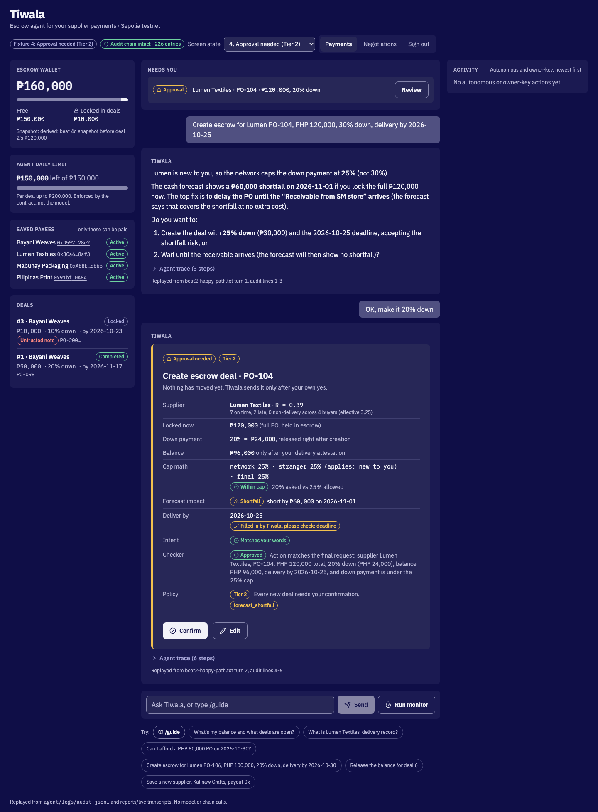
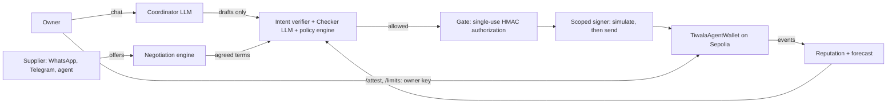

<h1 align="center"><b>TR8DE</b></h1>

<p align="center">
  An AI escrow wallet agent that negotiates with suppliers and pays them on-chain, within limits the contract enforces.<br>
  WeBank FinTechathon 2026 · International Track · Topic F
</p>

<p align="center">
  <a href="https://github.com/shaan8/TR8DE/actions/workflows/ci.yml"></a>
  <a href="https://sepolia.etherscan.io/address/0x2Fc37E4e02F4d10745875710cd54B52429A28C1a"></a>
</p>

<p align="center">
  
</p>

## What you can do

Ask in plain words:

- "What's my balance and what deals are open?"
- "What is Lumen Textiles' delivery record?"
- "Can I afford a PHP 80,000 PO on 2026-10-30?"
- "Create escrow for Lumen PO-106, PHP 100,000, 20% down, delivery by 2026-10-30". Inside your limits, the agent
  creates and funds it alone. Above them, or if it had to fill in a term, it shows a card and waits for your yes.
- "Release the balance for deal 6" (after `/attest 6`), "Cancel deal 5" (once overdue)
- "Save a new supplier, Kalinaw Crafts, payout 0x…": the agent checks the address, then you confirm with `yes` and its last 4 characters

Owner commands are typed by you, signed with the owner key, and never reachable by a model:

- `/attest N`: confirm delivery of deal N, which lets its balance be released
- `/approve N`: approve a deal above your approval threshold
- `/limits`: show the agent's spending envelope; `/limits <per deal> <per day> <on its own up to>` changes it
- `/dispute N`, `/resolve N release|refund`: freeze a deal, then settle it
- `/freeze`, `/unfreeze`: stop the agent and pause the wallet on-chain, then resume
- `/invite NAME`, `/whatsapp NAME NUMBER`: connect a saved supplier on Telegram or WhatsApp
- `/anchor`: write the audit log's head hash to Sepolia, so later edits are detectable
- `/tick`: run the monitor now (deadlines, attestations, balances); `/verify`: check the audit chain
- `/guide`: show this list in the app

The Negotiations tab bargains over quantity, price, deposit and delivery with a supplier (WhatsApp, Telegram or the
supplier's own agent), inside your private limits. It then carries the exact agreed terms into escrow.

# 0. How to deploy

### 0.1 Requirements

git, Node 18+, Python 3.11+. Copy `.env.example` to `.env` and fill in only what you need:

| Setting | Needed for |
| --- | --- |
| `DASHSCOPE_API_KEY` (Qwen Cloud, default). DeepSeek, OpenRouter or Anthropic keys also work | The chat assistant. Live payments need it, because the Checker fails closed without a model. Store it privately with `python3 scripts/setup_qwen.py` |
| 0.02 Sepolia test ETH | Live mode only. Free from a faucet, see 0.3 |
| `TIWALA_CHECKER_MODEL` (also `_COORDINATOR_`, `_TREASURY_`) | Optional. Run the Checker on a different model from the Coordinator, so one model's blind spot cannot pass its own plan |
| `TELEGRAM_BOT_TOKEN`, `WHATSAPP_*` | Optional live supplier chat ([telegram](docs/telegram.md), [whatsapp](docs/whatsapp-webhook.md)) |

### 0.2 Demo: local chain, one command, no accounts

```bash
git clone https://github.com/shaan8/TR8DE.git && cd TR8DE && ./scripts/local-demo.sh
```

The script starts a private chain and deploys the same contracts used on Sepolia, with seeded suppliers and trade
history. It then opens the console with a one-time login it prints. Ctrl+C stops it. Then:

1. **Negotiations**: open one with Lumen (simulated supplier agent) or Bayani (WhatsApp simulator, where you type
   as the supplier). When both sides agree, press "Recheck and prepare escrow".
2. **Payments**: confirm, then `/attest <deal>`. The balance is released and Lumen's on-chain record updates.
3. With a model key, type the create request above. It runs on its own inside the limits.

### 0.3 Live: your own deployment on Sepolia

1. Put a model key in `.env` (0.1). Optional: `SEPOLIA_RPC_URL` for your own RPC.
2. Run `./scripts/live.sh`. The first run creates a deployer key, prints its address and stops.
3. Send that address 0.02 Sepolia ETH from a faucet:
   [Google Cloud](https://cloud.google.com/application/web3/faucet/ethereum/sepolia),
   [pk910](https://sepolia-faucet.pk910.de) (no account) or
   [Alchemy](https://www.alchemy.com/faucets/ethereum-sepolia). To reuse a key, set `PRIVATE_KEY=0x…` instead.
   Never use a key that holds real funds.
4. Run `./scripts/live.sh` again. It creates the owner and agent keys, then deploys the token, factory and wallets.
   It seeds supplier history, asks for a console password and starts the console on `http://127.0.0.1:8000`.
   Allow about 50 minutes the first time. Later runs reuse the deployment and start in seconds.

Every payment, attestation and refund is then a Sepolia transaction linked to Etherscan from the console.

### 0.4 Other ways in

| Entry point | Command (from `agent/`) |
| --- | --- |
| Console, FastAPI + React | `cd ../ui && npm install && npm run build && cd ../agent && ../.venv/bin/uvicorn console.server:app --port 8000` |
| Console replays, no model or chain | `http://127.0.0.1:8000/?fixture=approval`; any of 21 states can be picked in the header |
| Streamlit chat, same owner login | `../.venv/bin/streamlit run app.py` |
| Terminal | `../.venv/bin/python -m tiwala_agent.cli --deployment ../deployments/11155111.json` |
| Contracts only | `./scripts/deploy-sepolia.sh` (about 110 txs, 0.1 to 0.3 Sepolia ETH) |

The monitor runs on its own every `MONITOR_INTERVAL_S` seconds (default 300). The agent reads event logs over wide
block ranges, so prefer an RPC without a tight `eth_getLogs` limit.

### 0.5 Demo vs live

| | Demo | Live |
| --- | --- | --- |
| Contracts, limits, escrow, attestation, refunds | Same | Same |
| Transactions | Throwaway chain; hashes are not public | Sepolia; every hash opens on Etherscan |
| Keys | Public Anvil test keys | Your own, kept in `.env` |
| Payees | Local addresses only | Any Sepolia address you save; payable after `PAYEE_DELAY` (10 min in the scripts, 24 h in our deployment) |
| WhatsApp, Telegram | Off whatever `.env` says; built-in simulator instead | Real messages both ways with credentials |
| No model key | Chat off; payments use a labelled rules-only Checker | Chat off; the Checker fails closed, so no payments |
| Persistence | Resets on every run | Stays on Sepolia |

### 0.6 Tests

```bash
npm install && git clone --depth 1 https://github.com/foundry-rs/forge-std lib/forge-std
forge test                                                        # 40 contract tests: unit, fuzz, invariant
python3 -m venv .venv && .venv/bin/pip install -r agent/requirements.txt
cd agent && PATH=$HOME/.foundry/bin:$PATH ../.venv/bin/python -m pytest -q   # 241 agent tests on anvil
cd ../ui && npx playwright test                                   # 58 UI state tests at 1440 and 390 px, with axe
```

Contract tests, agent tests and the UI build run in [CI](.github/workflows/ci.yml).

# 1. Technical documentation

### 1.1 System architecture



LLMs plan and check, deterministic code decides, and the contract has the final say. Each layer holds even if every
layer before it is fooled.

| Layer | Files |
| --- | --- |
| Contracts | [`TiwalaAgentWallet.sol`](src/TiwalaAgentWallet.sol) (escrow, owner and agent tiers), [`TiwalaFactory.sol`](src/TiwalaFactory.sol) (platform-gated wallets), [`SettlementToken.sol`](src/SettlementToken.sol) (tPHP) |
| LLM agents | [`agents.py`](agent/tiwala_agent/agents.py) (Coordinator, Treasury, Checker), [`llm.py`](agent/tiwala_agent/llm.py) (Qwen, DeepSeek, OpenRouter, Anthropic) |
| Deterministic gate | [`core.py`](agent/tiwala_agent/core.py) (orchestrator, Gate, confirmations, monitor), [`policy.py`](agent/tiwala_agent/policy.py), [`intent.py`](agent/tiwala_agent/intent.py), [`guard.py`](agent/tiwala_agent/guard.py), [`payee.py`](agent/tiwala_agent/payee.py) |
| Chain | [`chain.py`](agent/tiwala_agent/chain.py) (indexer, simulator, scoped signer, owner console) |
| Risk models | [`reputation.py`](agent/tiwala_agent/reputation.py), [`forecast.py`](agent/tiwala_agent/forecast.py) |
| Negotiation | [`negotiation.py`](agent/tiwala_agent/negotiation.py), [`negotiation_service.py`](agent/tiwala_agent/negotiation_service.py), [`supplier_agent.py`](agent/tiwala_agent/supplier_agent.py), [`whatsapp.py`](agent/tiwala_agent/whatsapp.py), [`telegram.py`](agent/tiwala_agent/telegram.py) |
| Interfaces | [`console/`](agent/console) (FastAPI, login), [`ui/src`](ui/src) (React), [`app.py`](agent/app.py) (Streamlit) |
| Audit | [`audit.py`](agent/tiwala_agent/audit.py), [`verify_audit.py`](scripts/verify_audit.py) |

### 1.2 Core algorithms

- **Agent authority** ([`policy.py`](agent/tiwala_agent/policy.py) `agent_authority`). A new deal runs at Tier 1,
  meaning the agent acts alone, only if all of these hold: it is at or below the contract's `approvalThreshold`
  and within today's limit; the payee is whitelisted and past its waiting period; the Checker approves; nothing
  is flagged; and the owner's own words state the supplier, total, down payment and PO. Otherwise it is Tier 2
  and needs a confirmation card.
- **Reputation and deposit cap** ([`reputation.py`](agent/tiwala_agent/reputation.py)). Reads every closed deal
  from factory wallets on chain. Each outcome is weighted by size against the buyer's running median: successes
  count at most 1, failures at least 1 and at most 3. A further weight comes from the buyer's own history.
  `R = min(1, k_eff/5) · (s+1)/(n+4)`, and the deposit cap is `10% + 40% · R`, floored to 5%. New pairings are
  held to a 25% stranger cap.
- **Liquidity forecast** ([`forecast.py`](agent/tiwala_agent/forecast.py)). Projects free funds minus a buffer
  across planned outflows and future inflows, then flags the first shortfall a new deal would cause and offers
  delay, split or top-up fixes.
- **Negotiation** ([`negotiation.py`](agent/tiwala_agent/negotiation.py), [design](docs/negotiation.md)).
  Proposals are versioned and hashed, and only an exact `ACCEPT <code>` for the open version counts. Agreed terms
  are rechecked on fresh chain state before escrow and again at the owner's yes.
- **Audit chain** ([`audit.py`](agent/tiwala_agent/audit.py)). Redacted JSONL with each entry hashing the previous
  one. `/anchor` writes the head to Sepolia, so a deleted tail is detected.

### 1.3 Security design

The full model is in [SECURITY.md](SECURITY.md#layered-controls). In short: models can only draft. Every action
needs a single-use Gate authorization minted after the policy allows it. Owner actions run only from typed
commands. Supplier and PO text is wrapped as data. The contract enforces payee whitelisting, waiting periods,
per-deal, daily and deposit caps, and owner-only attestation.

# 2. Source code

Repository: https://github.com/shaan8/TR8DE

| Path | Contents |
| --- | --- |
| [`src/`](src), [`test/`](test), [`script/`](script) | Solidity contracts, Foundry tests, deploy and seed scripts |
| [`agent/tiwala_agent/`](agent/tiwala_agent) | Python agent (section 1.1) |
| [`agent/console/`](agent/console), [`ui/`](ui) | Console API and React front end |
| [`agent/tests/`](agent/tests) | Unit, integration on anvil, red team, policy fuzz, the three external audits' probes |
| [`scripts/`](scripts) | `local-demo.sh`, `live.sh`, `deploy-sepolia.sh`, evidence and audit verification |
| [`docs/`](docs) | [Negotiation](docs/negotiation.md), [supplier API](docs/supplier-api.md), [Telegram](docs/telegram.md), [WhatsApp webhook](docs/whatsapp-webhook.md), [demo runbook](docs/demo-runbook.md) |

Deployment instructions are in section 0, and test cases in 0.6. Every test scenario is grouped by task completion,
safe execution, attacks blocked, and privacy and integrity in
[`reports/evidence/SUMMARY.md`](reports/evidence/SUMMARY.md).

The product was called Tiwala during development. The package (`tiwala_agent`), `TIWALA_*` settings and deployed
contract names keep that name, so the Sepolia evidence still matches.

# 3. Security self-assessment

Full report: [SECURITY.md](SECURITY.md).

**Permission tiers**

| Tier | Who acts | Examples |
| --- | --- | --- |
| 0 Read | Agent | Balances, deals, reputation, forecasts |
| 1 Autonomous | Agent alone | A deal stated in full inside `approvalThreshold`; deposit release; refund of an overdue deal; balance release after attestation |
| 2 Confirm | Agent, after the owner's yes on that exact card | Deals above the threshold, flagged, with agent-filled terms, or from a negotiation outside the agent's authority |
| 3 Refuse | Nobody | Unknown or blocklisted payee, intent mismatch, Checker rejection, over a cap |
| Owner only | Owner key, typed command | `/attest`, `/approve`, `/limits`, `/dispute`, `/resolve`, `/freeze`, saving a payee |

**Safety precautions**: input guard and intent verifier, a Checker on a separate model that fails closed,
single-use Gate authorizations, simulate-before-send, once-only creates (including across unmined
transactions), and card-bound confirmations. Also a circuit breaker after 3 refused payments, payee lookalike
checks, a hash-chained audit log anchored on chain, and an owner login on the console and Streamlit UI.

**Tests made**: 200,000-case policy fuzz (0 violations), Slither (0 high, 0 medium), a gitleaks secret scan, and a
live red team on Sepolia. Three external audits ran; every finding they reproduced is fixed and kept as a
regression test ([outcomes](SECURITY.md#independent-testing-18-october-2026)).

**Known risks** ([full list](SECURITY.md#known-limitations)): a stolen agent key can still spend within the
contract caps; the owner's attestation is trusted; seeded reputation is demo data, and Sybil resistance comes from
platform onboarding; there is no recency decay; forecast inflows are the owner's own assertions; the token is
for testing only. Not audited for production: do not use with real funds.

# 4. Execution evidence

| Contract | Address |
| --- | --- |
| Factory | [`0xDEF343FeeD80C2Dd4943B731bde56bb8932Bd569`](https://sepolia.etherscan.io/address/0xDEF343FeeD80C2Dd4943B731bde56bb8932Bd569) |
| Demo wallet | [`0x2Fc37E4e02F4d10745875710cd54B52429A28C1a`](https://sepolia.etherscan.io/address/0x2Fc37E4e02F4d10745875710cd54B52429A28C1a) |
| tPHP token | [`0x56E7D76Ca35BE2f19F63f10B6bf19e1367Cd634F`](https://sepolia.etherscan.io/address/0x56E7D76Ca35BE2f19F63f10B6bf19e1367Cd634F) |

Deployment and seeding: 111 transactions, 0 reverted, all listed in
[`reports/sepolia-evidence.md`](reports/sepolia-evidence.md). The live agent runs below used the deployed
contracts. Transcripts and the hash-chained audit log are in [`reports/live/`](reports/live).

| Beat | What happened | Transactions |
| --- | --- | --- |
| Happy path | Owner asks for 30% down to Lumen; the network caps it at 25%; deal created, deposit released | [create](https://sepolia.etherscan.io/tx/0xc26642d49f9e7079171076a8c5f6cf9f3c7b23537acc64b4aa4017b1200f953c), [deposit](https://sepolia.etherscan.io/tx/0xfb10145647f17ce77194b5a15bb5934b2fd3107b359674180e66f06a9be407de) |
| Milestone | Owner attests delivery; agent releases the balance | [attest](https://sepolia.etherscan.io/tx/0xb6a31fd50869448423ed8a9de70d7894c3ef7aafa51006d8d4787f1f4cb118e9), [release](https://sepolia.etherscan.io/tx/0x1862184b830f168131b8177215a10353a271eee28396d7b7aa2a357cb433e9d1) |
| Prompt injection | Instruction planted in an on-chain PO note is treated as data | [planted note](https://sepolia.etherscan.io/tx/0x06a326cfda226cca1dce0369e1118e9f1eaecfa831db75d6fa1b52926dacf205) |
| Contract backstop | Agent key forces `releaseBalance` on an unattested deal; the contract reverts | [reverted](https://sepolia.etherscan.io/tx/0x0479cd2d2ea18c2403a90278ef526e0adb5b04bf2365f3cb3088606a4e5168d0) |
| Overdue | Bayani misses the deadline; the monitor refunds; Bayani's cap drops to 15% | [create](https://sepolia.etherscan.io/tx/0x47d2f33dbe583bf674a39a7e03290843a5ad3d44a17cd35434feb11718aba1b7), [deposit](https://sepolia.etherscan.io/tx/0x8ae244f155da26305d8ce3dec956a3cf6bc8378dc144f90182a370b0a3ac42e3), [refund](https://sepolia.etherscan.io/tx/0xb16c7e1fb84a082e5efa60336faace9a99e3713020b7321245758fcbe5c212e7) |
| New payee | Owner saves Kalinaw Crafts; the owner key signs `addSupplier`; payment before the waiting period is refused | [addSupplier](https://sepolia.etherscan.io/tx/0x9a95283c0a3880fc06a7253858ae2a2c784edd01cdb270191932abf06a723111) |

Verify it yourself:

```bash
python3 scripts/verify_audit.py reports/live/audit.jsonl   # audit chain from the live runs, offline
```
