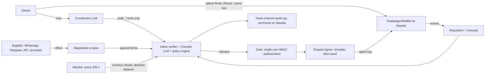
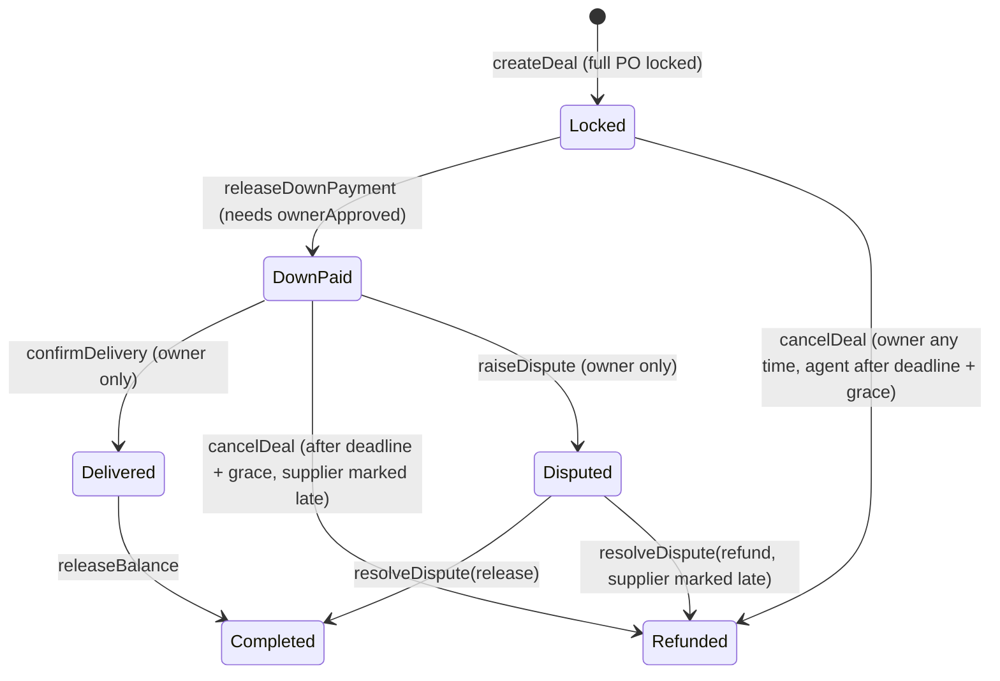

# 1. Technical documentation

TR8DE, WeBank FinTechathon 2026, International Track, Topic F.
Repository: https://github.com/shaan8/TR8DE. Live on Sepolia (chain 11155111).

## 1.0 What TR8DE is

TR8DE is an autonomous AI agent with its own on-chain wallet key. It works for a small business owner (the buyer)
who pays suppliers in advance and risks losing the deposit. In plain language the owner asks it to check balances,
judge a supplier, test cash flow, negotiate a purchase, and pay into escrow. The agent then signs and sends the
Sepolia transactions itself.

Its autonomy is real but bounded:

| The agent does on its own | Only the owner can do |
| --- | --- |
| Hold its own key (`0xCE2c…3e1a`) and sign transactions as the wallet's operator | Hold the owner key (`0x99d1…f3C3f8`) |
| Create an escrow deal the owner stated in full, at or below the contract's `approvalThreshold` | Approve a deal above `approvalThreshold` (`/approve`) |
| Release the agreed deposit, and the balance once delivery is attested | Attest delivery (`/attest`), the only path to a balance release |
| Refund an overdue deal to the wallet, on a timer, with no human prompt | Save a payee, change limits, pause, dispute, withdraw |
| Negotiate price, quantity, deposit and date with a supplier, round by round | Say yes to a card when the agent is outside its authority |

The line between the two columns is enforced three times: by deterministic Python, by a scoped signer, and by the
smart contract. A model that is fooled can draft a bad action but cannot sign one.

## 1.1 System architecture



### Layers

| Layer | Trust | Files |
| --- | --- | --- |
| Interfaces | Owner console (FastAPI + React) behind a login; Streamlit and CLI with the same login; supplier console per supplier token | [`agent/console/`](../../agent/console), [`ui/src/`](../../ui/src), [`agent/app.py`](../../agent/app.py) |
| LLM agents | Advisory only. Coordinator plans and drafts; Checker reviews on a separate model and fails closed; Treasury explains forecast fixes; buyer and supplier negotiators | [`agents.py`](../../agent/tiwala_agent/agents.py), [`llm.py`](../../agent/tiwala_agent/llm.py), [`negotiation.py`](../../agent/tiwala_agent/negotiation.py) |
| Deterministic gate | Decides. Input guard, intent verifier, policy engine, Gate, confirmations, circuit breaker | [`core.py`](../../agent/tiwala_agent/core.py), [`policy.py`](../../agent/tiwala_agent/policy.py), [`intent.py`](../../agent/tiwala_agent/intent.py), [`guard.py`](../../agent/tiwala_agent/guard.py), [`payee.py`](../../agent/tiwala_agent/payee.py) |
| Chain access | Indexer, `eth_call` simulation before every send, scoped agent signer, separate owner signer | [`chain.py`](../../agent/tiwala_agent/chain.py) |
| Contracts | Final say. Escrow, two key tiers, caps, payee waiting period, attestation | [`TiwalaAgentWallet.sol`](../../src/TiwalaAgentWallet.sol), [`TiwalaFactory.sol`](../../src/TiwalaFactory.sol), [`SettlementToken.sol`](../../src/SettlementToken.sol) |
| Risk models | Pure functions over on-chain history and the owner's plans | [`reputation.py`](../../agent/tiwala_agent/reputation.py), [`forecast.py`](../../agent/tiwala_agent/forecast.py) |
| Audit | Redacted, hash-chained JSONL; head hash written to Sepolia by `/anchor` | [`audit.py`](../../agent/tiwala_agent/audit.py), [`scripts/verify_audit.py`](../../scripts/verify_audit.py) |

### Contracts

`TiwalaFactory` (`0xDEF3…d569`) creates one `TiwalaAgentWallet` per onboarded buyer. Only the platform can create
wallets, and each wallet is linked to hashed real-world account IDs, so one business cannot appear as several
buyers to inflate a supplier's record.

`TiwalaAgentWallet` (`0x2Fc3…8C1a`) holds tPHP (a test peso token, 2 decimals) and has two roles:

| Role | Functions |
| --- | --- |
| Owner | `setAgent`, `setLimits`, `setEscrowPolicy`, `setPaused`, `addSupplier`, `removeSupplier`, `withdraw`, `approveDeal`, `confirmDelivery`, `extendDeadline`, `raiseDispute`, `resolveDispute` |
| Operator (agent or owner) | `createDeal`, `releaseDownPayment`, `releaseBalance`, `cancelDeal` |

Deal lifecycle:



What the contract enforces against the agent key, whatever the off-chain code does:

- payee must be listed by the owner and past `supplierDelay` (24 h on our deployment)
- `total <= perDealCap` (PHP 200,000), `downBps <= maxDownBps`, deadline in the future, enough free balance
- `needsApproval = msg.sender != owner && total > approvalThreshold` (PHP 150,000); the deposit then waits for
  `approveDeal`
- the agent's daily spend is capped (`dailyCap`, PHP 150,000 per UTC day)
- `releaseBalance` only from `Delivered`, which only the owner's `confirmDelivery` sets
- `pause` stops all agent payouts; every transfer path is `nonReentrant` and uses `SafeERC20`

### One chat turn, end to end

1. **Input guard** ([`guard.py`](../../agent/tiwala_agent/guard.py)). The owner's message is tagged and scanned for
   override, role-hijack, drain, raw-address, authority and delivery-claim patterns. Flags go to the audit log
   and the model; they never loosen anything. Text from the chain (PO notes) is escaped, cut to 120 characters
   and wrapped as quoted data.
2. **Owner commands bypass the model.** A message starting with `/` is parsed in code and signed with the owner
   key. No tool lets a model reach these functions.
3. **Coordinator loop** (at most 8 tool steps). The model sees redacted context
   ([`privacy.py`](../../agent/tiwala_agent/privacy.py): addresses become placeholders, phones and account numbers
   are masked) and can call read tools (`get_overview`, `get_supplier`, `forecast`) or `draft_*` tools. It has
   no tool that signs, reads files or reads settings.
4. **Each draft goes through `propose()`** ([`core.py`](../../agent/tiwala_agent/core.py)):
   frozen check, duplicate check, fresh chain context, intent verification against the owner's last messages,
   Checker review, then `policy.decide()`. The result is Tier 3 refuse, Tier 2 card, or Tier 1 execute.
5. **Execution.** The Gate mints an HMAC authorization over the exact action digest, tier and a nonce (60 s,
   single use). The executor refuses without it, simulates the call with `eth_call`, then sends with the agent
   key. A receipt timeout keeps the tx hash as `tx_pending`, and an unmined create blocks any second create for
   that PO.
6. **Grounded reply.** Any tx hash in the model's reply that this process did not produce replaces the reply, and
   peso amounts not taken from wallet data are flagged. Every exit path, including model errors and the step
   limit, lists the transactions already sent.

## 1.2 Core algorithms

### Agent authority (who decides)

`policy.agent_authority()` is the single place that decides whether a new deal runs at Tier 1. It returns a reason
for the owner, or nothing when the agent may act alone. All of these must hold for Tier 1:

1. The owner's own words state the supplier, total, down payment % and PO. Any term the model filled in
   (`intent.agent_filled`) sends it to a card that lists those terms.
2. `total <= approvalThreshold`, read from the contract.
3. `total <=` what is left under today's `dailyCap`.
4. The payee is listed on-chain and past its waiting period.
5. The Checker approved, and `policy.decide()` raised no flag (amount spike above 3x the buyer's median deal,
   forecast shortfall, low-score large deal, recently changed payout address).

Refusals (Tier 3) are unconditional: unknown or blocklisted payee, intent mismatch, Checker rejection, over a cap,
over the supplier's deposit cap, past deadline, insufficient free balance, per-supplier exposure above PHP 300,000,
action traced to contract text, or an origin other than the owner, the monitor or an agreed negotiation.

The owner moves the Tier 1 line with `/limits`, signed with the owner key. The agent cannot move it
(`test_the_agent_cannot_raise_its_own_authority`).

### Intent verification

[`intent.py`](../../agent/tiwala_agent/intent.py) parses the owner's last six messages in code: supplier names (also
first-word short forms), peso amounts, percentages, PO references and deal numbers. Every drafted action must match.
The latest percentage wins, so "No, make it 20%" corrects an earlier 25%. Wording such as "simulation", "dry run" or
"do not pay" is an intent mismatch, so nothing moves whatever the models say.

### Network reputation and deposit cap

[`reputation.py`](../../agent/tiwala_agent/reputation.py) reads every closed deal from every factory wallet on
Sepolia (`BalanceReleased`, `DealCancelled`, `DisputeResolved`). For supplier deal j at buyer b:

```
v_j    = min(3, T_j / median_T_b(j))      size relative to that buyer's causal median
w_j    = min(v_j, 1) for a success,  max(v_j, 1) for a failure, times beta_b
beta_b = 0.25 + 0.75 * min(1, h_b / 3)    buyers with little history count less (Sybil damping)
p      = (s + 1) / (n + 1 + 3)            Bayesian prior: a stranger starts at 0.25
R      = min(1, k_eff / 5) * p            k_eff: effective number of distinct buyers
cap    = floor_to_5%(10% + 40% * R), then a 25% stranger cap for a new buyer-supplier pair
```

The median is causal, so a later deal never re-weights an earlier one and a non-delivery never raises R. Size can
make a failure count more but a success never more than 1, so failing only small orders buys no higher cap. The
contract's `maxDownBps` is the hard ceiling if this code is wrong.

### Liquidity forecast

[`forecast.py`](../../agent/tiwala_agent/forecast.py): `H(t) = B_free + inflows(<= t) - outflows(<= t) - buffer`,
day by day over the owner's planned POs and expected receivables. A new PO is tested before it is drafted. The
first day H goes negative is the shortfall, and the Treasury agent ranks fixes: delay until a receivable lands,
split the order, or top up. Open escrow is already outside `B_free`, and inflows dated before today are ignored,
since they are already in the on-chain balance.

### Negotiation

[`negotiation.py`](../../agent/tiwala_agent/negotiation.py), design in [`docs/negotiation.md`](../negotiation.md).

- Each offer is a version `NEG-<id>-v<n>` with integer terms (quantity, centavos, basis points, unix seconds), an
  expiry (24 h) and a SHA-256 terms hash. A person accepts only with `ACCEPT <first 6 hex of the hash>` for the
  open version. "okay" moves the negotiation to `awaiting_clarification` and asks for the code.
- The buyer side checks every offer in code against private limits read fresh from chain: reserve after the full
  lock, budget, per-deal cap, the supplier's deposit cap, quantity and delivery window. A model may suggest the
  counter. If it fails a check, does not parse or is down, the deterministic strategy concedes at most half of
  the remaining room per round. At most 8 rounds, then it comes back to the owner.
- Each side's limits stay in its own model context and store (`test_private_limits_stay_on_their_own_side`).
- Agreement inside the agent's authority goes to escrow by itself. Otherwise "Recheck and prepare escrow" rereads
  chain state and drafts a `create_deal` that must equal the agreement. Expiry, terms hash and every hard
  constraint are rechecked again at the owner's yes.

### Monitor

Every `MONITOR_INTERVAL_S` (300 s) and on `/tick`, the monitor reads open deals. It refunds overdue deals past
deadline plus grace (`cancelDeal`), releases balances the owner has attested, and warns about underfunding and
forecast gaps. These run at Tier 1 without a human prompt, and the policy allows the monitor nothing else.

### Audit chain

[`audit.py`](../../agent/tiwala_agent/audit.py): each JSONL entry stores `prev` and `hash = sha256(prev + entry)`.
Secrets are redacted before writing. Appends hold a thread lock and an exclusive file lock. `/anchor` writes the
head hash and entry count to Sepolia from the owner key, so edits, deletions and tail truncation up to the last
anchor are detected offline by [`scripts/verify_audit.py`](../../scripts/verify_audit.py).

## 1.3 Security design

The design assumes every model can be fooled. Each layer holds even if every layer above it fails.

| # | Layer | What it stops |
| --- | --- | --- |
| 1 | Models only draft; no signing tool, no settings or file tool | A hijacked model cannot move money or read secrets |
| 2 | Input guard; contract and supplier text wrapped as data | Indirect prompt injection through PO notes and supplier replies |
| 3 | Intent verifier in code against the owner's own words | Wrong supplier, amount, %, PO or deal; "it's only a simulation" pretexts |
| 4 | Checker on a separate model, fails closed | One model's blind spot passing its own plan |
| 5 | Policy engine and `agent_authority()` | Anything outside the owner's envelope runs only after a yes, or never |
| 6 | Single-use HMAC Gate authorization | Executing an action the policy did not allow, or twice |
| 7 | Confirmation bound to a card id, re-checked on fresh chain state | Stale or replaced cards, expired negotiated terms |
| 8 | Payee rules (owner-typed address, checksum, lookalikes, last-4 confirmation, owner key signs) | Address poisoning and induced transfers to new payees |
| 9 | Scoped signer, `eth_call` simulation before every send | Sending a call the contract would reject |
| 10 | Contract caps, waiting period, attestation, `pause` | Everything above failing, including a stolen agent key |
| 11 | Circuit breaker (3 suspicious refusals in 10 min) and `/freeze` | Repeated attack attempts |
| 12 | Owner login, CSRF header, session limits, body cap, webhook gate | Reaching the console or webhook from outside |
| 13 | Hash-chained audit log anchored on-chain | Hiding what happened afterwards |

Full threat model, tiers, test results and known risks: [5. Security self-assessment](5-security-self-assessment.md)
and [`SECURITY.md`](../../SECURITY.md).

## 1.4 Dialogue design

| Behaviour | How it works | Evidence |
| --- | --- | --- |
| Efficient | A deal stated in full and inside the owner's limits is created and funded in one message, no card | `test_owner_stated_in_budget_deal_still_runs_on_its_own` |
| Clarification | Missing or ambiguous fields (which PO, supplier, amount, %, date) are asked for, not invented; any field the agent fills is listed on the card; supplier "okay" asks for the exact code | Coordinator prompt in [`agents.py`](../../agent/tiwala_agent/agents.py), `test_ambiguous_okay_does_not_accept`, live [beat 2](../../reports/live/beat2-happy-path.txt) |
| Correction | "Make it 15% down" redrafts the card and re-runs every check; the latest stated % wins | `test_correction_redraft_then_confirm`, `test_intent_correction_latest_percent_wins`, live beat 2 |
| Fallback | Provider chain (Qwen, DeepSeek, OpenRouter, Anthropic); Checker fails closed; negotiation falls back to rules; supplier agent hands to its person; forecast offers delay, split or top-up; every error reply lists what was already sent | `test_provider_falls_back_to_the_one_with_a_key`, `test_buyer_model_garbage_falls_back_to_rules`, `test_model_failure_after_execution_must_not_say_nothing_was_sent` |

## 1.5 Technology

Solidity 0.8 with OpenZeppelin and Foundry; Python 3.11+ with web3.py, FastAPI and Streamlit; React with Vite and
Tailwind; models through Qwen Cloud (default), DeepSeek, OpenRouter or Anthropic; WhatsApp Cloud API and Telegram
Bot API for supplier chat; Sepolia via any RPC.
