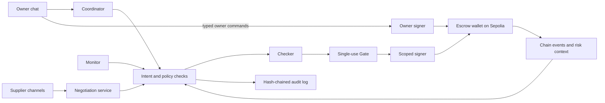
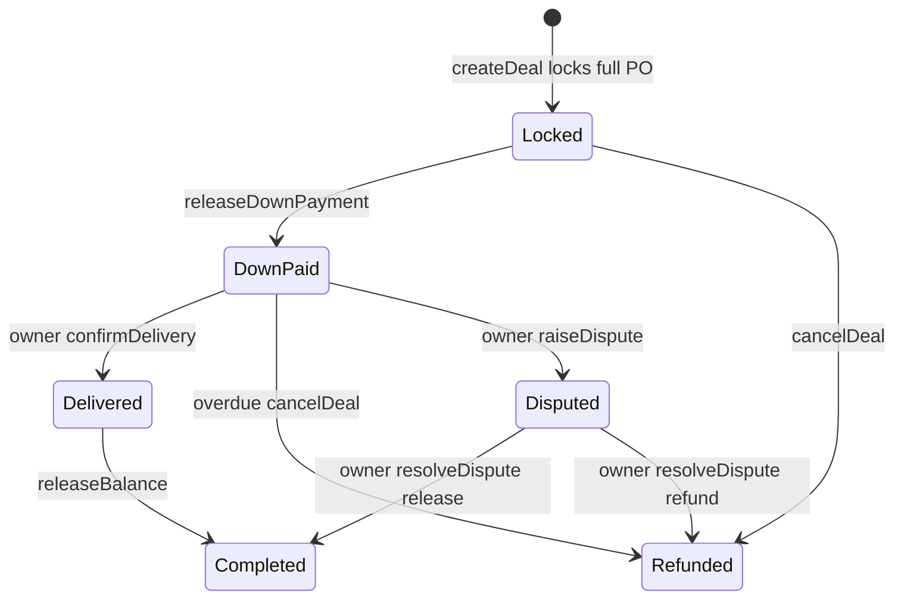

# 1. Technical documentation

TR8DE | WeBank FinTechathon 2026 | International Track, Topic F

TR8DE helps a small business pay suppliers without giving an AI model unrestricted access to its money. The owner can ask about cash, supplier history or an order in ordinary language. The agent can negotiate and, when the owner has stated the deal completely and the deal fits the limits, create escrow and send the deposit on Sepolia. It holds a separate operator key and signs those transactions itself. The money sits in a wallet contract; the owner retains a different key for limits, payees, approvals and delivery attestation.

This document describes the deployed architecture, the decisions made in code, and the boundary between a model suggestion and a signed transaction. The [security self-assessment](5-security-self-assessment.md) gives the attack results and unresolved risks. tPHP is a test token with no redemption value; the system has not been tested with real businesses.

## 1.1 System architecture

There are three entry points. The authenticated owner console takes chat and typed commands; Streamlit uses the same login, and the CLI relies on local host access. A supplier can negotiate through WhatsApp, Telegram, the supplier page or its API. The monitor wakes every 300 seconds by default and checks open deals. All three paths use the same policy before an agent-key transaction. The owner-only command path is deliberately separate and never enters a model tool.

The Coordinator and Treasury roles default to Qwen `qwen3.7-plus`; the independent Checker defaults to `qwen3.8-flash`. Those settings can be changed per role. The Coordinator has read tools and `draft_*` tools. It has no signing, file or settings tool. The Checker reviews an action but cannot authorize it by itself. The core code is in [agents.py](../../agent/tiwala_agent/agents.py), [core.py](../../agent/tiwala_agent/core.py) and [policy.py](../../agent/tiwala_agent/policy.py).

The chain adapter in [chain.py](../../agent/tiwala_agent/chain.py) reads the wallet and its events, simulates a permitted call with `eth_call`, and then uses the scoped agent signer. The owner signer handles only typed owner commands. [reputation.py](../../agent/tiwala_agent/reputation.py) derives supplier history from factory wallets; [forecast.py](../../agent/tiwala_agent/forecast.py) uses free wallet balance and the owner's plans. [audit.py](../../agent/tiwala_agent/audit.py) records each decision and transaction in a redacted hash chain.

### What is on-chain

[TiwalaFactory.sol](../../src/TiwalaFactory.sol) creates wallets only for platform-onboarded buyers and prevents reuse of an account hash. This limits duplicate onboarding but does not establish real-world identity; the platform must check that itself. The deployed factory is `0xDEF3…d569`. The demo [TiwalaAgentWallet.sol](../../src/TiwalaAgentWallet.sol) is `0x2Fc3…8C1a`; it holds [SettlementToken.sol](../../src/SettlementToken.sol) tPHP with two decimal places.

The contract gives the owner `setAgent`, `setLimits`, `setEscrowPolicy`, payee management, pause, withdrawal, deal approval, delivery attestation and dispute resolution. The owner or operator may create a deal, release a deposit, release an attested balance and cancel when the relevant conditions hold. The agent cannot call owner-only functions, even if the off-chain process is compromised.

A create requires a listed payee past its waiting period, a future deadline, enough free balance and a total within the per-deal cap. The agent's deposit percentage cannot exceed the contract maximum. Above the `approvalThreshold`, an agent-created deal remains locked until the owner sends `approveDeal`. Agent payouts count against the daily cap. A balance can be released only after the owner's `confirmDelivery`. The contract uses `SafeERC20`, reentrancy guards on transfers and an owner pause. Our deployment has a PHP 200,000 per-deal cap, PHP 150,000 daily agent-payout cap and PHP 150,000 autonomous approval threshold.

For a PHP 20,000 order at 20% down, `createDeal` locks PHP 20,000. `releaseDownPayment` sends PHP 4,000 to the supplier. The remaining PHP 16,000 stays locked until the owner attests delivery. If an overdue deal is cancelled, only the unpaid escrow returns to the wallet; a deposit already sent cannot be recovered by that refund.

### One request through the agent

1. [guard.py](../../agent/tiwala_agent/guard.py) tags override and authority claims. On-chain PO notes are truncated, escaped and presented as quoted data. They cannot become owner instructions.
2. The Coordinator sees a redacted view of the conversation. [privacy.py](../../agent/tiwala_agent/privacy.py) masks contact and account identifiers and replaces wallet addresses with placeholders. It may read context or draft an action, with at most eight tool steps.
3. For every draft, [core.py](../../agent/tiwala_agent/core.py) checks freeze state, duplicates and fresh chain data. [intent.py](../../agent/tiwala_agent/intent.py) compares the draft with the owner's words; the Checker reviews it; [policy.py](../../agent/tiwala_agent/policy.py) returns autonomous, confirm or refuse.
4. An allowed action gets a single-use HMAC Gate authorization bound to its digest, tier and nonce for 60 seconds. The executor simulates the exact call and only then signs with the agent key. A receipt timeout retains the hash as `tx_pending`; an unmined create blocks another create for the same PO.
5. The reply is grounded in the recorded outcome. A model-supplied transaction hash that this process did not produce is replaced. Errors and tool-step limits still report transactions already broadcast during the turn.

## 1.2 Core decision rules

### How much the agent may do alone

`policy.agent_authority()` controls autonomous creation. It requires the owner's own words to state the supplier, total, deposit percentage and PO reference. If the model filled any of those terms, the owner sees the term on a confirmation card. The total must fit the contract's approval threshold and today's remaining agent allowance. The payee must be active, the Checker must approve and there must be no risk flag. Flags include a deal more than three times the buyer's median, a forecast shortfall, a low-score large deal or a recently changed payout address.

Refusal wins over confirmation. An unknown or blocked payee, mismatch with owner intent, rejected Checker, breached hard cap, insufficient free balance, past deadline or action traced to contract text is refused. A card cannot override those reasons. A create above the supplier's computed deposit cap is refused; a later fall in that cap on an existing deal is shown for confirmation. The owner can change contract limits with a typed, owner-signed `/limits` command. The agent cannot raise its own authority.

The intent verifier parses the last six owner messages for suppliers, peso amounts, percentages, PO references and deal numbers. The latest correction wins: “No, make it 20%” replaces an earlier 25%. Phrases such as “dry run” or “do not pay” block a payment. Delivery-date wording is a known gap: the parser does not independently bind the owner's date to the drafted deadline. The Checker reviews it and code requires a future deadline, but the [security assessment](5-security-self-assessment.md) lists the residual risk as R19.

### Supplier history and deposit cap

Reputation comes from closed deals emitted by every factory wallet on Sepolia: completed balances, cancellations and dispute resolutions. It is not a model judgment. For each supplier deal, the code compares its size with that buyer's causal median. A success counts at most one unit; a failure at least one and at most three. A buyer with little history receives a smaller weight, `beta = 0.25 + 0.75 × min(1, history / 3)`. With weighted successes `s`, failures `n` and effective distinct buyers `k_eff`, the score is `R = min(1, k_eff / 5) × (s + 1) / (n + 4)`. The deposit cap is `floor_to_5%(10% + 40% × R)`; a new buyer-supplier pair is also subject to a 25% stranger cap.

The median is calculated from history available before each outcome, so later trades cannot reweight earlier ones. A failed small order cannot improve the score. The contract's `maxDownBps` remains a hard ceiling if this off-chain score is wrong. The starting supplier history was seeded for the demo and should not be presented as independent trade data.

### Cash forecast

For each future day, the forecast computes `H(t) = free balance + expected inflows by t - planned outflows by t - buffer`. It reports the first day H becomes negative. The Treasury role can suggest delaying a PO until a receivable arrives, splitting it or topping up. Escrow already locked is outside free balance; past-dated receivables are not added again. Planned inflows are owner assertions, so optimistic dates can hide a shortfall. The contract still refuses an unfunded escrow.

### Negotiation

[negotiation.py](../../agent/tiwala_agent/negotiation.py) stores each offer as `NEG-<id>-v<n>` with integer quantity, centavos, basis points and a Unix deadline. A 24-hour expiry and SHA-256 terms hash identify the open version. A supplier's “okay” is ambiguous and asks for the exact `ACCEPT <six-character code>`; only that code accepts the current version. A counter makes old codes stale.

Before any buyer counter, code checks budget, reserve after locking the full PO, per-deal and supplier deposit caps, quantity and delivery window against fresh chain state. A model may suggest terms; invalid or unparseable output falls back to a deterministic concession rule that moves at most half the remaining room per round. Eight rounds is the maximum. The supplier-facing sentence is rendered from the validated structured offer, so it cannot contradict the numbers. Private constraints stay buyer-side, although a visible offer can still reveal willingness to pay.

An unflagged agreement inside the agent's authority can create escrow itself. A flagged supplier thread cannot. If the owner requests escrow later, the agreement hash, expiry and hard constraints are checked again when the card is confirmed. The [negotiation design](../negotiation.md) describes the supplier interfaces and state transitions.

### Monitor and audit

The monitor runs every `MONITOR_INTERVAL_S` seconds, 300 by default, or when the owner types `/tick`. It may cancel an overdue deal after its grace period and release a balance that the owner already attested. It warns about underfunding and forecast gaps but cannot create a deal or pay a deposit.

The audit log stores JSONL entries with `prev` and `hash = SHA-256(prev + entry)`. Secrets are redacted before writing; appends use both a thread lock and file lock. An owner-signed `/anchor` writes the head hash and entry count to Sepolia. [verify_audit.py](../../scripts/verify_audit.py) can then detect edits, deletions and tail truncation up to that anchor.

## 1.3 Security boundaries and dialogue

The model is useful for interpreting the request, explaining a forecast and proposing a counteroffer. Authority comes from code and keys. Intent matching, blocklists, renewed payee cooling on releases and duplicate prevention are off-chain; a stolen agent key can bypass them. The contract still enforces roles, caps and deal states, but its release-time payee and underfunded-deposit gaps are disclosed as R4 and R16 in [document 5](5-security-self-assessment.md).

The conversation is designed to ask only where it must. A complete in-budget instruction can create and fund a deal in one turn. Missing or ambiguous terms lead to a question or a card showing the filled fields. A correction redraws the card and reruns checks. If a model provider fails, the system tries the next configured provider; the Checker fails closed if none is available. Negotiation has a rules-based fallback, while a supplier agent can hand the thread to its person. If a transaction was already sent before an error, the reply says so and gives its hash.

The owner console is intended to bind to `127.0.0.1`. Its login, same-origin write checks, size limit and session expiry protect local access; the WhatsApp tunnel exposes only the signed webhook. The demo keeps owner and agent keys on one machine. A production version needs separate owner signing, a contract redeployment for the known gaps, and a supplier-data retention policy.

## 1.4 Verification and reproduction

The implementation is in [TR8DE on GitHub](https://github.com/shaan8/TR8DE): contracts and Foundry tests in `src/` and `test/`, Python agent and tests in `agent/`, console in `agent/console/`, React UI in `ui/`, and run scripts in `scripts/`. [README section 0](../../README.md#0-how-to-deploy) gives a local demo with a private chain and a live Sepolia setup. The code still uses the development name `tiwala_agent` and `TIWALA_*` settings, so those names match the deployed records.

[CI run 34](https://github.com/shaan8/TR8DE/actions/runs/39398585275) passed contract tests, agent scenarios, UI build and the secret scan. All 249 agent tests passed locally on 20 October 2026. The [scenario report](../../reports/evidence/SUMMARY.md) pins source commit `217fa48` and records 228/228 selected scenarios and 200,000 policy cases with no observed violation; the generated report was committed in `bbfe5bc`. Foundry passed 39 unit/fuzz tests and one invariant suite with three invariants. The 58 Playwright UI checks passed locally; CI builds the UI but does not run Playwright.

Sepolia hashes for escrow, deposit, attestation, balance release, overdue refund and a reverted unauthorized release are linked in the [README evidence section](../../README.md#4-execution-evidence). The separate 300-prompt campaign used live Qwen against pinned public Sepolia state and committed its results with six zero-value transactions. Broadcasts were disabled during the prompts; those six hashes are evidence commitments, not payment outcomes. The [README recording](6-execution-evidence.md#621-new-readme-recording-20-october-2026) adds a verified owner-confirmed PHP 1,000 escrow and 200 tPHP deposit for deal 9. The [walkthrough index](../walkthrough-videos.md) identifies the ten clips and remaining scenario coverage.
